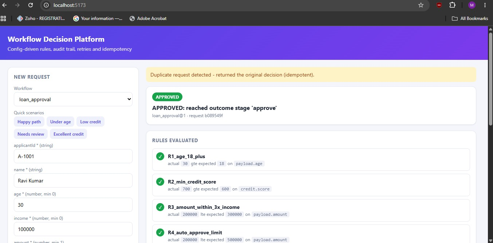

# Configurable Workflow Decision Platform (MERN)

A generic, configuration-driven platform that takes structured requests, validates them, evaluates rules, runs multi-stage workflows, keeps state and a full audit trail, and handles failures, retries and duplicates. New business use cases are added with JSON configuration, not code.

**Stack:** MongoDB (Mongoose) · Express · React (Vite) · Node.js

## Features
- 3 workflows on one generic engine: loan approval, claim processing, vendor approval (JSON only, no per-use-case code)
- Rules: mandatory checks, thresholds, `all`/`any` conditions, field-to-field comparison, conditional branching, multi-stage evaluation
- Outcomes: approved, rejected, manual review (with human decision), pending retry
- Idempotency: header key or payload hash, DB unique index, 409 if a key is reused with a different payload
- Dependency retries with backoff, checkpointed execution, safe resume after a partial save failure
- Workflow versioning: requests are pinned to their version; dry-run and replay show the impact of rule changes
- Config validation at load time (unknown stages, bad operators, unreachable stages)
- Full audit log and explainable decisions (expected vs actual values for every rule)
- React dashboard, Docker Compose, GitHub Actions CI

## Run

```
cd server && npm i && npm test                       # tests, no database needed
MONGO_URI=mongodb://localhost:27017/wdp npm start    # omit MONGO_URI => in-memory repo
cd client && npm i && npm run dev                    # UI on :5173, proxies /api to :4000

docker compose up --build                            # full stack (API + Mongo + UI) on :8080
```

Start the backend before the UI. Without `MONGO_URI` the data is kept in memory and resets on restart.

## API

| Method | Path | Purpose |
|---|---|---|
| POST | `/api/workflows/:id/requests` (header `Idempotency-Key` optional) | Intake. 201 new, 200 duplicate, 409 key reused with different payload, 422 invalid |
| GET | `/api/workflows` | List workflows, versions and schemas |
| POST | `/api/workflows/reload` | Hot-load new workflow JSON / versions |
| POST | `/api/workflows/:id/simulate?version=N` | Dry run: evaluate a payload, save nothing |
| POST | `/api/workflows/:id/replay?version=N` | Re-evaluate past requests under another version and report which decisions change |
| GET | `/api/requests`, `/api/requests/:id` | List requests, get current state |
| GET | `/api/requests/:id/audit` | Full append-only audit log |
| GET | `/api/requests/:id/explain` | Decision explanation (input, rules, data, outcome, history) |
| POST | `/api/requests/:id/retry` | Resume a request that is waiting on a failed dependency (or stuck after a failed save) |
| POST | `/api/requests/:id/review` `{decision, reviewer, note}` | Resolve a request in manual review |
| POST | `/api/simulate/bureau-failures` `{count}` | Demo helper: make the simulated dependency fail N times |

## Architecture

```
React UI -> Express routes (app.js) -> WorkflowService (intake, idempotency, retry, review, explain, simulate, replay)
                                         -> Executor (stage state machine) -> Conditions (rule evaluator)
                                         -> Services (simulated creditBureau, policyService)
                                         -> Registry + ConfigValidator (versioned JSON workflows)
                                         -> Repo interface: MongoRepo | MemoryRepo   (requests + append-only audit)
```

Separation of concerns: **config** (what to decide), **engine** (how, domain-agnostic), **repo** (persistence), **transport** (HTTP).
Nothing in `engine/` knows about loans, claims or vendors; a new use case is a new JSON file in `server/config/workflows/`.

### Configuration model
A workflow is `{id, version, schema, start, stages}`.

| Stage type | Purpose |
|---|---|
| `rules` | List of `{id, when, onFail: reject \| manual_review \| continue, reason}` |
| `dependency` | Calls a service with mapped inputs, retry policy, `onExhausted: pending \| manual_review`, result stored under `store` |
| `branch` | First matching `when` goes to `goto`, else `default` |
| `outcome` | Terminal: `approved`, `rejected` or `manual_review` |

Conditions are `{field, op, value}` or `{field, op, valueFrom, factor}`, combinable with `all` / `any`.
Operators: `eq ne gt gte lt lte in exists`. Fields address `payload.*` or stored dependency results (for example `credit.score`).

Included workflows:
- `loan_approval`: external credit check, thresholds, branching on credit score
- `claim_processing`: policy lookup, coverage check, compound risk rule
- `vendor_approval`: rules only, branches on years in business

### Data flow
intake -> schema validation (422, nothing stored) -> idempotency lookup -> insert (unique index) -> execute stages, checkpointing after each -> terminal state (APPROVED / REJECTED / MANUAL_REVIEW) or PENDING_RETRY. Every step appends an audit event.

### Robustness decisions
- **Idempotency**: key = header or SHA-256(workflow + canonical payload). A unique index on `(workflowId, idempotencyKey)` makes races safe, and the loser of a race returns the winner's record. Reusing a key with a different payload returns 409.
- **Dependency failure**: bounded in-stage retries with exponential backoff. On exhaustion the request parks as `PENDING_RETRY` at that stage (or goes to manual review if configured). Retry resumes from the checkpoint and does not re-run earlier rules (tested).
- **Partial save failure**: state is saved after each stage. If a write fails, the request stays at its last checkpoint and `retry` re-runs only the unsaved stage. Stages are pure over (payload, context), so replay is safe. The audit event is written before the state write, so the audit may over-report but never under-report.
- **Requirement changes**: each request is pinned to the workflow version it arrived under, so new versions affect only new requests. `simulate` and `replay` let you preview the effect of a change before adopting it.
- **Config safety**: workflows are validated when loaded, so a malformed file fails fast with all problems listed.
- **Audit and explanation**: per-rule events carry expected vs actual values (the data reference). `/explain` returns input, external data, rules with pass/fail and values, outcome and state history.

### Trade-offs and assumptions
- Declarative JSON DSL instead of embedded scripts: safe and inspectable, but not Turing-complete. The escape hatch is adding an operator or a registered service.
- Synchronous execution inside the request for simplicity. The executor is queue-agnostic.
- MongoDB without multi-document transactions: single-document request updates plus an append-only audit. Ordering favours audit completeness.
- Retry is manual only; there is no scheduler.
- Authentication, RBAC and per-field masking are out of scope.
- External dependencies are simulated and deterministic (the credit score and policy data depend on a prefix of the input value).

### Scaling considerations
- Stateless API nodes behind a load balancer.
- Move `execute` to a queue (BullMQ / SQS) with workers, and drive `PENDING_RETRY` with a delayed-job scheduler.
- Shard by `workflowId` or request id.
- Audit in its own collection, with TTL / archival to cold storage.
- Cache the registry and invalidate it on reload.
- Circuit breaker around dependencies.
- Optimistic versioning on requests to guard against concurrent workers.

## Decision explanation example
`GET /api/requests/:id/explain` for a loan request with amount 900000 and income 100000:

```
input:        {age: 30, income: 100000, amount: 900000, pan: "OKAY1"}
externalData: {credit: {score: 700}}
rules:        R1_age_18_plus             PASS  (30 >= 18)
              R2_min_credit_score        PASS  (700 >= 600)
              R3_amount_within_3x_income FAIL  (900000 <= 300000)
outcome:      MANUAL_REVIEW - "R3_amount_within_3x_income failed: Amount exceeds 3x income"
```

Other scenarios (age 17 gives REJECTED by R1; score 800 skips R4 through the branch; a credit-bureau outage gives PENDING_RETRY then resumes) are asserted in `server/test/`.

## Tests
`cd server && npm test` covers: happy path with rule trace, invalid input, mandatory-rule reject, manual review and human decision, duplicate requests, key reuse with a different payload, dependency failure with in-stage recovery, outage then retry without re-running earlier stages, partial save failure and resume, rule version change with in-flight pinning, dry-run and replay, config validation, and the claim and vendor workflows.

## Documentation
- [Architecture](docs/architecture.md): components, data flow, decision log, scaling
- [Decision examples](docs/decision-examples.md): real input, rules triggered, outcome and audit reasoning

## Screenshots
